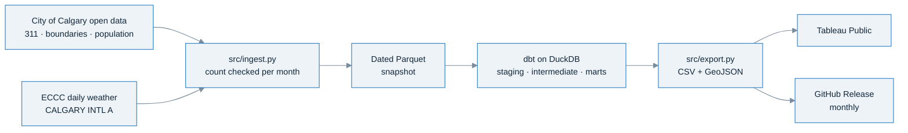
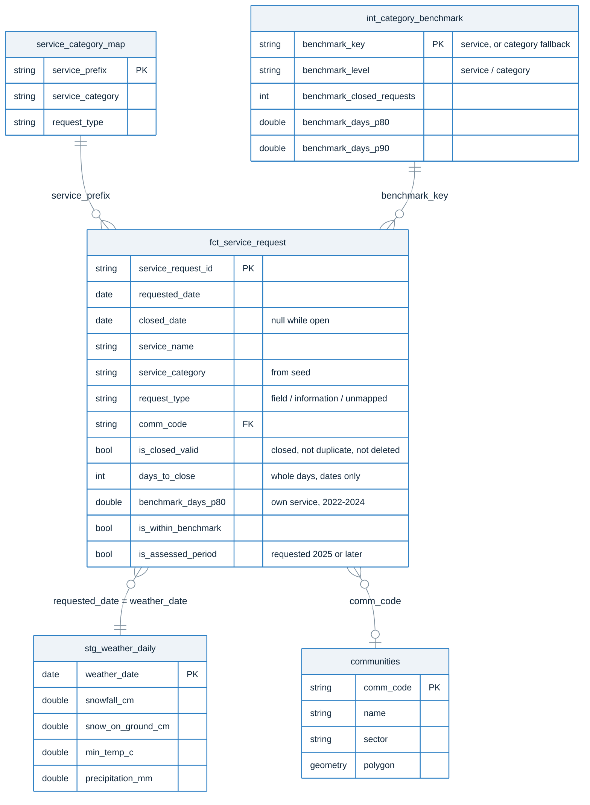

# Calgary 311 Service Performance

Operations analytics on 2.49 million real City of Calgary 311 service requests (January 2022 onward): how fast crews close requests against a defensible benchmark, where old work piles up, and when demand peaks. Built from public data with Python, dbt and DuckDB, refreshed monthly by GitHub Actions, and reported in Tableau Public.


| | | |
|---|---|---|
| **2.49M** requests since 2022 | **34,661** field requests open 90+ days (Oct 2026) | **+17%** on October 2022 |
| **77%** of that old work in Roads & Mobility | **1 of 9** field services slipped (Fire, 82% to 75%) | **$0** to run |

All data is real. Figures are from the development snapshot of 2026-11-19; the final snapshot is 2026-12-01. Every number traces to a query in [`docs/evidence_log.md`](docs/evidence_log.md).

[](https://public.tableau.com/app/profile/nelson.lefebvre/viz/calgary_311/Calgary311ServicePerformance)

*Click the image to open the interactive dashboard on Tableau Public (filters and tooltips).*

> The final `2026-12-01` snapshot is next; figures will move slightly.

---

## The business problem

Calgary's 311 receives about 500,000 requests a year, from missed garbage carts to sidewalk repairs. Each one goes to a business unit that sends a crew and closes the request. The City publishes every request as open data, but three things keep it from answering a simple operations question, *are we keeping up?*

1. **No targets.** The City publishes no response-time target per service, so "slow" has no reference.
2. **"Closed" is not "done".** A 2021 City audit found requests closed when they were handed to another department. Closing speed is measurable; resolution is not.
3. **Old work is invisible.** Dashboards built on new requests show how fast today's work closes. They say nothing about the stock of requests that has been open for months.

The project builds what an operations manager would need to answer that question: an internal benchmark per service, a month-by-month rebuild of the open backlog, and the timing of demand peaks against the weather.

## Who this is for

A **fictional operations manager** of a City business unit, such as Roads or Waste & Recycling. The stakeholder is invented and named as such; the data is not.

| Decision | How often | What they need to know |
|---|---|---|
| Where to send crews this week | Weekly | Which services and communities hold the oldest open requests |
| Whether a service is slipping | Monthly | Time to close against the service's own benchmark, and the trend |
| How to staff for peaks | Quarterly | When volume peaks, by how much, and whether weather drives it |

Secondary reader: 311 leadership, who want one page to report upward. Full scoping, user stories and MoSCoW in [`docs/scoping.md`](docs/scoping.md).

## Requirements: what, why, and where it is answered

| Need | What was built | Why this way | Where |
|---|---|---|---|
| Know which services are slipping | Share of requests closed within the service's own benchmark, 2022-2024 against 2025 onward | The City has no targets; judging each service against its own past shows drift without pretending to know the right speed | Timeliness view, [`kpi_dictionary.md`](docs/kpi_dictionary.md) |
| See whether old work piles up | Backlog rebuilt at every month end, by age band, category and community | Open requests are a stock: they need a month-end snapshot, not a sum over time | Backlog view, `fct_backlog_monthly` |
| Know where to send crews | Old backlog by community on a map | Request coordinates are community centre points, so the community is the finest honest level | Map view |
| Plan winter staffing | Snow requests against snowfall on earlier days | Residents report after the clearing window, so same-day weather shows nothing | Weather view, [`analysis_notes.md`](docs/analysis_notes.md) |
| Trust the numbers | Row counts checked against the API, monthly totals reconciled with a second City extract, dbt tests | A silent partial download would shrink every figure | [`data_quality.md`](docs/data_quality.md), [`evidence_log.md`](docs/evidence_log.md) |
| Report upward in one page | Executive memo: answer first, three numbers, decisions requested | Leadership reads one page, not a dashboard | [`exec_memo.md`](docs/exec_memo.md) |
| Keep it current at no cost | Monthly GitHub Actions job that rebuilds everything and publishes the extracts | Free on a public repo, no cloud account or secret | [`refresh.yml`](.github/workflows/refresh.yml) |

## What the data says

| Question | Answer (snapshot 2026-11-19) |
|---|---|
| Which services close requests slowest against their benchmark? | Among field services, only **Fire** slipped clearly (82% to 75% within benchmark). The others held or improved; Roads & Mobility went from 82% to 88%. |
| Is old work piling up? | Yes. Field requests open 90+ days hit their highest October level: **34,661**, +17% on 2022 and +32% on 2025. Roads & Mobility holds 77% of them, mostly scheduled repairs. |
| When does demand peak? | June runs 74% above February. Snow-related requests peak about **two days after** snowfall, not on the day. |

The answer to *are we keeping up?* is two answers: **yes on new work, no on old work.** Recommended decisions are in the [executive memo](docs/exec_memo.md). Details and caveats: [`docs/analysis_notes.md`](docs/analysis_notes.md).

## The problem worth talking about

Two numbers in this data would mislead anyone who took them at face value.

1. **The map.** Every geolocated request sits on its community's centre point, not on the request address. A dot map would show neat clusters that don't exist, so all maps here are by community.
2. **"Closed".** Requests closed on transfer make closing look faster than the work. The metric is therefore *time to close*, not *time to resolve*, and 26,489 contact-form items that were simply never closed are kept out of the backlog.

And one number the project itself got wrong. The first timeliness table said Roads & Mobility held flat at 78%. Rebuilding every figure for the dashboard from the model gave 82% to 88%: Roads improved. The table, README and memo were corrected and the query now sits under the table. The same rebuild found that one mart grouped by category but not by request type, which blended two kinds of Animal Services request. Both are logged in [`docs/ai_log.md`](docs/ai_log.md).

All data findings and how each is handled: [`docs/data_quality.md`](docs/data_quality.md).

## How it's built



- **Ingestion.** The SODA API is read month by month, and each month's row count must equal the API's own count or the run stops. Requests opened before 2022 and still open are pulled separately, because the backlog needs them.
- **Modelling.** dbt on DuckDB, in three layers. One request-level fact, `fct_service_request`, carries the benchmark verdict for each request. Aggregate marts sit at a stated grain, and the backlog mart is semi-additive: it is summed across categories and communities, never across months.
- **Benchmark.** Each request is judged against the 80th percentile time to close of its own service in 2022-2024, with a category fallback for services too small to have a stable percentile.
- **Reporting.** [Tableau Public dashboard](https://public.tableau.com/app/profile/nelson.lefebvre/viz/calgary_311/Calgary311ServicePerformance) with two screens: **Priorities** (which communities and request types to send crews to first, with shared filters for service, days open, request type and month, and a three-month trend) and **Monthly situation** (headline figures against the year before, trends, services slipping against their own benchmark). `tableau/build_workbook.py` writes the sources, shared parameters, calculated fields and sheets; the layout is built by hand in Tableau Public. Model and decisions: [`docs/ARCHITECTURE.md`](docs/ARCHITECTURE.md#tableau-model).
- **Refresh.** A GitHub Actions job runs the whole chain on the 1st of each month and publishes the extracts as a Release. There is no cloud database: Tableau Public cannot connect to one live, and 2.5 million rows fit on a laptop.

### Data model

One request-level fact carries the benchmark verdict; the aggregate marts and the Tableau extracts are built from it. Grain of every table and the semi-additive rule for the backlog are in [`docs/ARCHITECTURE.md`](docs/ARCHITECTURE.md#data-model).



Pipeline, dbt lineage, data model (entity diagram), grain of every table, tests and trade-offs: [`docs/ARCHITECTURE.md`](docs/ARCHITECTURE.md).

## What this project demonstrates

| Skill | Evidence here |
|---|---|
| Scoping a business need | Stakeholder, decisions, questions, MoSCoW and success criteria written before any query ([`scoping.md`](docs/scoping.md)) |
| Defensible KPIs | A benchmark built where none exists, with its limits stated ([`kpi_dictionary.md`](docs/kpi_dictionary.md)) |
| Applied statistics | Percentiles, semi-additive stock measures, lagged correlation, seasonality |
| Data quality on real data | 14 anomalies profiled and handled, two independent completeness checks ([`data_quality.md`](docs/data_quality.md)) |
| Tableau and storytelling | Dashboard, executive memo and a README written for a reader who has 30 seconds |
| Automation at zero cost | dbt tests and a scheduled pipeline on GitHub Actions |
| Working with AI, critically | Every AI mistake caught and how ([`ai_log.md`](docs/ai_log.md)) |

## Run it

```powershell
uv sync
uv run python -m src.ingest --snapshot 2026-12-01
cd dbt; uv run dbt build --profiles-dir . --vars "{snapshot: 2026-12-01}"; cd ..
uv run python -m src.export
uv run python tableau/build_workbook.py   # workbook + Hyper extracts, then File > Save to Tableau Public
```

Or run **Actions > Monthly refresh > Run workflow** on GitHub and download the files from the Release it creates.

## How I used AI

I built this project with Claude Code as a pair programmer.

- **Claude drafted:** scaffolding, ingestion and dbt boilerplate, first versions of the docs and dashboard code.
- **I decided:** the business questions, KPI definitions, the internal benchmark, the analysis period and how each data anomaly is handled.
- **I verified:** every published number is logged with its query in `docs/evidence_log.md`, and every dashboard figure is recomputed from the exports.
- **Where AI got it wrong:** it compared December with October backlog, which inflated growth to +48% (same-month: +17%), and it left a stale timeliness table in the notes. All cases are in [`docs/ai_log.md`](docs/ai_log.md).

## Data sources and licence

- City of Calgary Open Data: 311 Service Requests (`iahh-g8bj`, `arf6-qysm`), Community District Boundaries (`surr-xmvs`), Historical Community Populations (`jtpc-xgsh`). Licence and attribution: *to confirm from the [Open Calgary Terms of Use](https://data.calgary.ca/d/Open-Data-Terms/u45n-7awa)*.
- Environment and Climate Change Canada, historical daily climate data, station CALGARY INTL A (climate ID 3031092).
