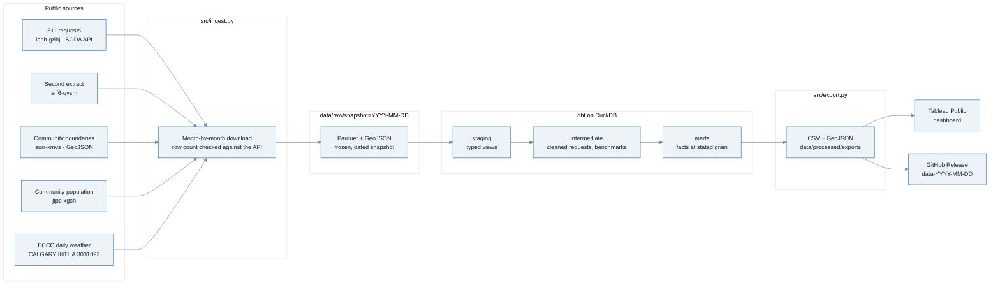
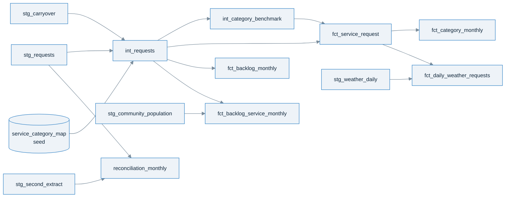
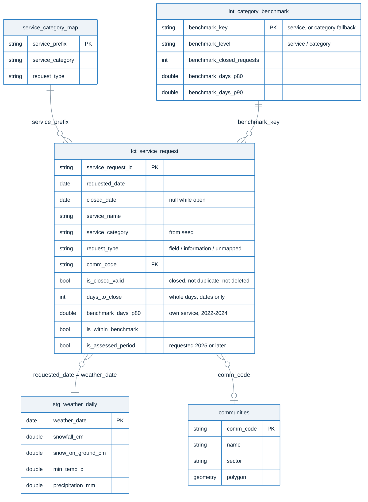
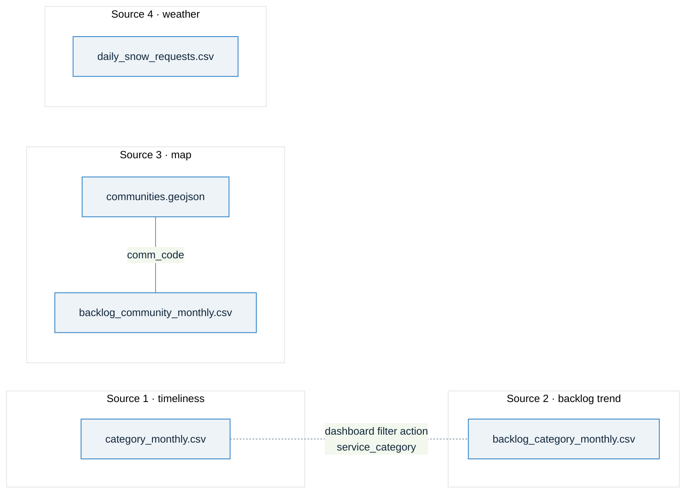

# Architecture and implementation

How the data gets from the City's open data portal to the dashboard, what each table holds, and the choices made on the way. Business context and requirements are in the [README](../README.md) and [`scoping.md`](scoping.md); KPI definitions in [`kpi_dictionary.md`](kpi_dictionary.md).

## Pipeline



The whole chain runs on a laptop in about an hour (the API serves roughly one month of requests per minute) and costs nothing. [`.github/workflows/refresh.yml`](../.github/workflows/refresh.yml) runs the same four commands on the 1st of each month and publishes the exports as a GitHub Release.

## Sources

| Source | Id | What it gives | Used for |
|---|---|---|---|
| 311 Service Requests | `iahh-g8bj` | One row per request since 2010: dates (no time of day), status, service, community | Everything |
| 311 Service Requests (separate extract) | `arf6-qysm` | Same requests from a different table, capped at 1M rows | Reconciliation, 2024 only |
| Community District Boundaries | `surr-xmvs` | 313 community polygons with `comm_code` | Map |
| Historical Community Populations | `jtpc-xgsh` | Population by community, last census 2019 | Context only |
| ECCC historical daily climate | station 3031092 | Snowfall, snow on ground, temperature, precipitation | Weather association |

The portal also lists "Monthly", "by Community" and "by Channel" 311 datasets. They are saved charts on `iahh-g8bj` (same `tableId`), so they cannot serve as an independent check.

### Terms

City of Calgary data is published under the Open Government Licence - City of Calgary (to confirm on the [Terms of Use page](https://data.calgary.ca/d/Open-Data-Terms/u45n-7awa) before publishing). ECCC data is published under the Open Government Licence - Canada. Both allow reuse with attribution.

## dbt lineage



`stg_carryover` holds requests opened before 2022 and still open at the start of the period. Only the backlog uses them; without them 48,244 open requests vanished from the stock (see [`ai_log.md`](ai_log.md)).

## Data model



The aggregate marts are built from `fct_service_request` (or `int_requests` for the backlog) and carry no foreign keys of their own:

| Table | Grain (one row is) | Rows | Additive? |
|---|---|---|---|
| `fct_service_request` | one request | 2,471,994 | yes (counts) |
| `fct_category_monthly` | service category x request type x month of request | 987 | counts yes; ratios and medians no, recompute from counts |
| `fct_backlog_monthly` | month end x category x request type x community x age band | 377,576 | across categories and communities yes; across months **no** (a stock) |
| `fct_backlog_service_monthly` | month end x request type x category x service name x community x age band, last 13 month ends, with the value 3 month ends earlier | 317,531 | same as `fct_backlog_monthly` |
| `fct_daily_weather_requests` | day x service category | 28,014 | yes |
| `reconciliation_monthly` | month (only 2024 is comparable) | 35 | n/a |
| `int_category_benchmark` | service (or category fallback) | 463 | n/a |

Two rules follow from that table and apply in every tool that reads the marts:

- A ratio is computed from its numerator and denominator at the grain shown, never averaged: `sum(closed_within_benchmark) / sum(closed_with_benchmark)`.
- The backlog is filtered to one month end before it is summed. Adding two month ends counts the same open requests twice.

## Tableau model

The dashboard has two screens. **Priorities** (weekly): which communities and which request types to send crews to first. **Monthly situation**: an overview for a monthly review. `tableau/build_workbook.py` writes the data sources, parameters, calculated fields and one sheet per visual; the dashboard layout is done by hand in Tableau Public.

| Source | File | Grain | Used by |
|---|---|---|---|
| Operations backlog | `backlog_service_community_monthly.csv` (+ `communities.geojson` on `comm_code` for the map) | month end x request type x category x service name x community x days open, last 13 month ends | Priorities: map, priority table, 3-month trend, communities |
| Monthly KPIs | `monthly_kpis.csv` | request month, field requests | Both screens: headline figures; monthly trends |
| Timeliness | `category_monthly.csv` | category x request type x month | Monthly: slipping services, seasonality |
| Snow | `daily_snow_requests.csv` | day | Monthly: snow lag |

The sources have different grains, so a normal Tableau filter acts on one source only. The shared filters are **parameters** (Category, Days open, Request type, Month end, Per 1,000 residents). Each source has a `Keep row` calculated field that compares its rows with the parameters, and every sheet keeps the rows where it is true. The priority sheets set it as a context filter so their Top 25 is computed after it. Monthly KPIs are city-wide field requests: they have no category column, and a Roads & Mobility share per category would mean nothing.

Two dates on one screen are deliberate. A month-end backlog stock is final once the month is over (latest: October 2026). Flow figures (requests, share closed within benchmark) wait two months, because most requests of the last month are not closed yet (latest complete: September 2026). Each tile says which month it shows.

Per 1,000 residents uses the 2019 municipal census, divides by the community's population once (not once per row), and is shown only by community.

Earlier version of the model (one source per question):



Relating the other files on month or category would mix a month of request with a month-end stock, and Tableau would add values that do not add up.

## Tests

| Layer | Test | Why |
|---|---|---|
| Ingestion | Each month's row count equals the API's `count(*)` at download, or the run fails | A silent partial page would shrink every figure |
| Ingestion | Boundaries file must have geometry and `comm_code` on every feature | `ab7m-fwn6` once returned 313 features with null geometry |
| Ingestion (pytest) | Month windows cross year ends and include the partial last month | Off-by-one months are the classic API pagination bug |
| Staging | `service_request_id` unique and not null; `status_description` in accepted values | Duplicated or unexpected rows |
| Staging | `weather_date` unique | One weather row per day, or the join multiplies requests |
| Marts | Unique grain on `fct_category_monthly` and `fct_backlog_monthly` | Catches a missing group-by column (it did once: see `ai_log.md`) |
| Marts | `days_to_close` never negative | Closing before opening means a parsing error |
| Marts | Each 2024 month within 1.5% of `arf6-qysm` | The only independent check on completeness (0.2-1.1% in practice) |
| Marts | At least 97% of requests mapped to a category | Keeps the "Other" bucket small enough to ignore |
| Intermediate | A closed request has a closing date on or after its request date | Internal consistency of status and dates |
| Marts | Every request day has a weather row (warns) | The weather join must not drop days silently |

`dbt build` currently gives 20 passing tests and 1 warning (plus 17 pytest checks on the exports and the workbook: `uv run pytest`): 5 request days have no weather row at the airport station, kept as nulls.

## Running it

```powershell
uv sync
uv run python -m src.ingest --snapshot 2026-12-01
cd dbt; uv run dbt build --profiles-dir . --vars "{snapshot: 2026-12-01}"; cd ..
uv run python -m src.export
uv run python tableau/build_workbook.py
```

`tableau/build_workbook.py` writes `tableau/calgary_311.twb` (sources, parameters, calculated fields, sheets, empty dashboards) and one Hyper extract per source in `data/processed/extracts/` (Tableau Public only saves workbooks built on extracts). Open the workbook in Tableau Public and use File > Save to Tableau Public.

Or trigger **Actions > Monthly refresh > Run workflow** on GitHub and download the Release. GitHub disables a scheduled workflow after 60 days without repository activity; re-enable it from the Actions tab.

## Assumed trade-offs

| Choice | Alternative | Why |
|---|---|---|
| DuckDB + CSV exports | Cloud database (Azure SQL free offer was planned) | Tableau Public cannot connect live to a database, and 2.5M rows fit on a laptop. The cloud database added cost risk and setup with no change for the reader |
| GitHub Actions monthly job | Scheduled cloud function | Free on a public repository, no account or secret to manage |
| Internal benchmark (P80 of 2022-2024 per service) | Official targets | The City publishes none. Each service is judged against its own past, so the ranking says who drifted, not who is slow by nature |
| Time to close | Time to resolve | The data records when a request was closed, not whether the work was done |
| Community-level maps only | Point map | Every geolocated request sits on its community's centre point |
| Period from 2022 | Full history from 2010 | Earlier years carry known logic errors and a different closing practice |
| Whole days | Hours | The dataset has dates without times |
